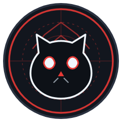

<div align="center">



# ⚛️ ATLAS — Codebase Intelligence Platform

**Understand any repository in minutes, not days.** Atlas maps a codebase into an
AST-driven architecture graph, narrates it in plain language, and lets you question
your own code with a persistent AI assistant.

`TypeScript` `React` `Node.js` `Express` `SQLite` `Tree-sitter` `Vite`

[](https://www.typescriptlang.org)
[](https://react.dev)
[](https://nodejs.org)
[](https://sqlite.org)
[](tests/isolation.test.ts)
[]()

</div>

---

## ✨ What is Atlas?

Atlas (also known as **CodeAtlas**) is a self-hosted, privacy-first platform for
**codebase comprehension**. Point it at a local directory or a GitHub repository and it
will:

- 🔍 **Parse every file** into an AST (Tree-sitter) and build a full symbol + dependency graph
- 🏗️ **Cluster the architecture** into layers and modules, and flag structural drift — circular dependencies, god files, hub modules, dead exports
- 💬 **Answer questions about your code** through **Atlas**, the built-in assistant — with verified file provenance on every claim
- 🧠 **Remember your conversations** — chat history is persisted per account in SQLite and survives refreshes, navigation and re-login
- 🔐 **Keep everything local** — analysis runs on your machine; no code ever leaves the perimeter

## 🧭 Feature Tour

| | Feature | Description |
|---|---|---|
| 📊 | **Overview Dashboard** | Architecture health score, layer composition, entry-path guidance, coupled-module ranking |
| 🗺️ | **Architecture Explorer** | Interactive module clusters with drill-down to any file |
| 🕸️ | **Dependency Graph** | Topological DAG of the full import graph with circular-isolation filters |
| 📁 | **Code Explorer** | Syntax-aware code browsing with one-click "Ask Atlas about this file" |
| ⚠️ | **Findings** | Prioritized structural issues (critical → warning) with evidence and fixes |
| 📄 | **Docs Workspace** | Auto-generated narrative documentation per module |
| 🤖 | **Ask Atlas (AI)** | Persistent, searchable, renameable chat sessions backed by SQLite |
| 🕘 | **Analysis History** | Multi-repo workspace: every analyzed repository is cached, re-openable and re-runnable |
| ⚙️ | **Settings Hub** | Profile, security (password + session management), GitHub integration, AI engine config, data export/deletion |

### 🆕 Persistent Chat History

Every Atlas conversation is **automatically saved server-side**:

- Titles are derived from your first question
- Follow-up context is rebuilt from stored history — correct even after a browser refresh
- Retries can never duplicate messages (unique per-message client IDs)
- Search across titles **and** message content, rename, delete (with confirmation), or export everything as JSON
- Strictly **owner-scoped**: one user can never read, modify or delete another's chats

## 🚀 Getting Started

### Prerequisites

- **Node.js ≥ 22** (tested on 24)
- A **GitHub OAuth App** (for sign-in) — create one at <https://github.com/settings/developers> with callback `<your-origin>/api/auth/github/callback`

### Install & Run

```bash
git clone https://github.com/Psudhanshu-07/Atlas.git
cd Atlas

npm install

# Configure
cp .env.example .env
#   → fill in GITHUB_CLIENT_ID and GITHUB_CLIENT_SECRET
#   → optionally set OPENAI_API_KEY (any OpenAI-compatible endpoint) for AI answers

# Development (API on :3001, web on :5173)
npm run dev

# Production
npm run build      # builds the web client into dist/
npm start          # serves API + built client on :3001
```

Open **http://localhost:5173**, sign in with GitHub, click **Connect**, and analyze the
bundled `samples/demo-app` for a guided tour.

## 🧪 Tests

The acceptance suite (`tests/isolation.test.ts`) covers authentication, multi-user data
isolation, chat-history ownership, retry dedup, analysis caching and OAuth mechanics:

```bash
npm test   # 119 checks
```

## 🗂️ Project Structure

```
├── server/            Express API, crawler, analyzer, AI engine, SQLite store
│   ├── analyze/       Tree-sitter parsing, clustering, findings, narratives
│   ├── chat.ts        Persistent chat-history routes (owner-scoped)
│   ├── db.ts          Versioned SQLite migrations (v1–v6)
│   └── auth.ts        GitHub OAuth, sessions, password credentials
├── src/               React client (Vite)
│   ├── components/    Views, layout, chat history panel, modals
│   └── styles/        Dark-first design system
├── shared/            Type contracts shared by client & server
├── samples/           demo-app — a deliberately flawed sample repo for demos
└── tests/             End-to-end acceptance & isolation suite
```

## 🔐 Security Model

- Sessions are 256-bit random tokens; only SHA-256 hashes are stored, in `HttpOnly` cookies
- Every workspace and chat query is bound to the **server-side session identity** — client-supplied IDs are never trusted
- GitHub OAuth tokens are encrypted at rest with a locally generated key
- Local-path analysis is sandboxed to the project root (+ operator allow-list)

## 📊 Sample Analysis Snapshot

> `samples/demo-app` analyzed: **40 files · 1,283 LOC · 8 modules · 67 dependency edges · 13 structural findings** in under a second — no AI calls required.

## 🛣️ Roadmap-check

- [x] Persistent multi-user chat history
- [x] Settings hub with session management
- [x] Chat export & deletion (data ownership)
- [ ] Team workspaces & shared annotations
- [ ] Monorepo support with package-level scoping

---

<div align="center">

Built with ⚡ by **[Psudhanshu-07](https://github.com/Psudhanshu-07)**

</div>
